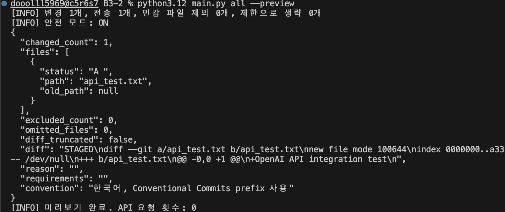
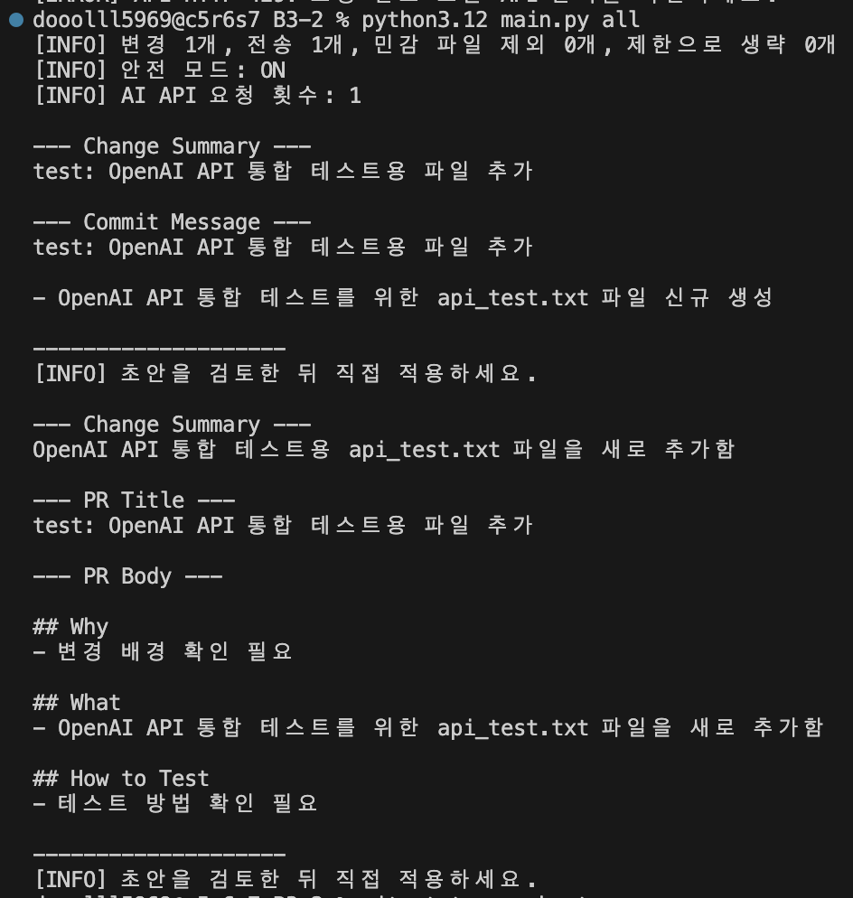
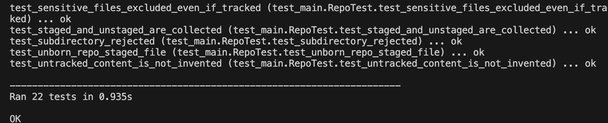
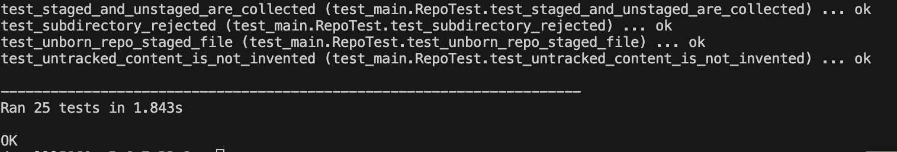

# B3-2 · AI Git 커밋/PR 초안 생성기

Git 변경 내용을 읽어 AI로 **변경 요약·커밋 메시지·PR 제목과 본문**을 만드는 Python CLI입니다. 출력한 초안은 검토 후 복사해 사용합니다.

2026-11-07 실제 OpenAI API(`gpt-4.1-mini`)로 입력 diff에서 커밋 메시지와 PR 초안을 생성했습니다. 아래에 당시 입력과 실제 출력을 수록했습니다. 이후 API 응답 처리·개인키 보호를 보강한 현재 코드는 모의 API 기반 자동 테스트 25개를 통과했습니다. [요구사항별 검증 상태](docs/verification.md)

## 설치

Python **3.10 이상**, Git, 인터넷 연결이 필요합니다. 외부 Python 패키지는 사용하지 않습니다.

```bash
git clone https://github.com/dooolll00/B3-2.git
cd B3-2
python3.12 -m venv .venv
source .venv/bin/activate
python main.py --help
```

Python 3.10 이상이 필요합니다. 실행 환경에 설치된 Python 버전을 확인한 뒤 적절한 실행 파일을 사용하세요. 본 프로젝트는 Python 3.12.13에서 검증했습니다. `.venv` 활성화 후의 `python`은 그 버전을 사용합니다.

## API 키 설정

OpenAI API 키는 환경변수 `AI_API_KEY`로만 받습니다. `OPENAI_API_KEY`도 대체 이름으로 지원하며 둘 다 있으면 `AI_API_KEY`를 우선합니다. `.env` 파일은 읽지 않습니다.

macOS 기본 zsh에서 아래 명령은 입력한 키를 화면과 명령 기록에 남기지 않고 현재 터미널에 설정합니다.

```zsh
read -s "AI_API_KEY?OpenAI API Key: "
export AI_API_KEY
printf '\n'
```

API 키를 코드·README·작업 기록·스크린샷에 넣지 마세요. API 사용 가능 모델과 잔액은 계정별로 확인해야 합니다. 작업을 마치면 `unset AI_API_KEY`로 현재 셸에서 해제할 수 있습니다.

## Git 변경 준비와 전송 미리보기

대상 Git 저장소 **루트**에서 실행합니다. 도구를 다른 저장소에 적용할 때는 그 저장소로 이동한 뒤 `python /경로/B3-2/main.py commit`처럼 실행하세요.

```bash
# Git 저장소 루트에서 실행합니다.
git status

# 변경 사항이 있다면 전송 내용을 미리 확인합니다.
python main.py all --preview

# 새 파일의 내용까지 분석하려면 먼저 스테이징합니다.
# git add 파일명
```

- `git status --porcelain=v1 -z`로 파일과 상태를 읽습니다.
- `git diff`와 `git diff --cached`를 각각 읽어 미스테이징·스테이징 변경을 함께 전달합니다.
- 미추적 파일은 이름만 포함합니다. **새 파일의 내용까지 요약하려면 먼저 `git add 파일명`으로 스테이징하세요.**
- 변경이 없으면 키 없이도 정상 종료하며 API 요청은 0회입니다.
- `--preview`는 실제 전송할 JSON을 출력하고 종료합니다. API 요청은 0회입니다.
- 병합 충돌은 먼저 해결하도록 안내합니다. 바이너리 파일은 Git diff의 변경 표시만 전달하며 내용을 분석하지 않습니다.
- PR도 현재 작업 트리와 스테이징 변경을 요약합니다. 이미 커밋한 브랜치 전체나 원격 브랜치와의 차이는 수집하지 않습니다.

## 실행

```bash
# 커밋 초안
python main.py commit --reason '잘못된 입력을 조기에 차단하기 위해'

# PR 초안
python main.py pr --requirements 'Why/What/How to Test를 한국어로 작성'

# 한 번의 실행과 보통 1회 API 호출로 커밋과 PR을 함께 생성
python main.py all --max-tokens 2500

# 모델과 생성 파라미터 변경
python main.py commit --model gpt-4.1-mini --temperature 0.2 --max-tokens 1500

# 팀 표현 규칙과 전송 범위 변경
python main.py pr --convention 'docs/fix/feat prefix, 한국어, 과장 금지' --max-files 5 --max-lines 120
```

기본 모델은 `gpt-4.1-mini`입니다. 다른 모델을 지정할 때는 Chat Completions·JSON object·temperature 파라미터 지원 여부를 확인하세요. 지원하지 않는 조합은 API 요청 오류로 안내합니다.

| 옵션 | 기본값 | 의미 |
|---|---|---|
| 명령 | 필수 | `commit`, `pr`, `all` |
| `--model` | `gpt-4.1-mini` | 요청 모델 |
| `--temperature` | `0.2` | 0~2, 낮을수록 표현 변동을 줄이는 방향. 사실 정확성을 보장하지 않음 |
| `--max-tokens` | `1500` | API의 `max_completion_tokens`로 보내는 최대 출력 토큰 수. 글자 수와 다름 |
| `--safe-mode` | ON | 패턴 마스킹과 파일·줄 제한 |
| `--no-safe-mode` | 미사용 | 패턴 마스킹·파일·줄 제한 해제. 민감 파일·개인키 포함 파일 제외와 환경변수 API 키 제거는 유지 |
| `--max-files` | `10` | 안전 모드에서 전송할 최대 파일 수 |
| `--max-lines` | `200` | 안전 모드에서 파일별 diff를 합친 최대 줄 수(안내 표식 제외) |
| `--reason` | 빈 값 | 변경 배경. 없으면 AI에 확인 필요로 표현하도록 지시 |
| `--requirements` | 빈 값 | 요구사항 맥락 |
| `--convention` | 한국어·Conventional Commits | 팀 표현 규칙을 프롬프트에 추가 |
| `--preview` | 미사용 | 입력만 출력, 실제 API 호출 없음 |

`-model`, `-temperature`, `-max-tokens`, `-safe-mode` 별칭도 지원합니다. 모든 옵션은 명령 뒤에 넣으세요.

## 실제 수행 결과

아래는 **2026-11-07 사용자가 실행한 터미널 기록의 실제 입력과 OpenAI 응답**입니다. 설명용으로 만든 출력이 아닙니다. 실행 환경은 macOS·Python 3.12.13이며 기본 모델 `gpt-4.1-mini`, temperature `0.2`, 최대 출력 토큰 `1500`, 안전 모드 ON을 사용했습니다.

### 1. Git 변경 준비와 입력 확인

당시 테스트 파일을 만들고 스테이징한 후 미리보기를 실행했습니다. `api_test.txt`는 검증 후 스테이징을 해제하고 삭제했습니다.

```bash
printf 'OpenAI API integration test\n' > api_test.txt
git add api_test.txt
python3.12 main.py all --preview
```

미리보기에서 확인한 실제 diff입니다. JSON 문자열에 표시된 줄바꿈을 읽기 쉽게 풀어 표기했습니다.

```diff
diff --git a/api_test.txt b/api_test.txt
new file mode 100644
index 0000000..a33e291
--- /dev/null
+++ b/api_test.txt
@@ -0,0 +1 @@
+OpenAI API integration test
```

| 확인 항목 | 실제 결과 |
|---|---|
| 파일 상태 | `A ` — 스테이징된 새 파일 |
| 변경 / 전송 파일 | 1개 / 1개 |
| 민감 파일 제외 / 제한으로 생략 | 0개 / 0개 |
| diff 생략 여부 | `diff_truncated: false` |
| 미리보기 API 요청 | 0회 |
| 변경 배경·요구사항 | 입력하지 않음 |

실제 입력 미리보기 화면입니다.



### 2. 실제 API 호출과 생성 결과

```bash
python3.12 main.py all
```

아래는 API 요청 1회로 커밋 메시지와 PR 초안을 함께 생성한 실제 출력입니다.

```text
[INFO] 변경 1개, 전송 1개, 민감 파일 제외 0개, 제한으로 생략 0개
[INFO] 안전 모드: ON
[INFO] AI API 요청 횟수: 1

--- Change Summary ---
test: OpenAI API 통합 테스트용 파일 추가

--- Commit Message ---
test: OpenAI API 통합 테스트용 파일 추가

- OpenAI API 통합 테스트를 위한 api_test.txt 파일 신규 생성

--------------------
[INFO] 초안을 검토한 뒤 직접 적용하세요.

--- Change Summary ---
OpenAI API 통합 테스트용 api_test.txt 파일을 새로 추가함

--- PR Title ---
test: OpenAI API 통합 테스트용 파일 추가

--- PR Body ---

## Why
- 변경 배경 확인 필요

## What
- OpenAI API 통합 테스트를 위한 api_test.txt 파일을 새로 추가함

## How to Test
- 테스트 방법 확인 필요

--------------------
[INFO] 초안을 검토한 뒤 직접 적용하세요.
```

### 3. 입력과 결과 대조

입력은 통합 테스트 문구 한 줄을 담은 `api_test.txt`의 신규 추가이며, 커밋 본문과 PR의 What도 같은 파일의 신규 추가를 요약했습니다. 변경 배경을 입력하지 않았으므로 Why는 확인 필요로 표시했고, How to Test도 테스트를 실행했다고 주장하지 않고 확인 필요로 표시했습니다. 따라서 이 단순 파일 추가 사례에서 입력 변경과 요약의 일치를 확인했습니다. 복잡한 코드 변경의 요약 품질까지 검증한 결과는 아닙니다.

아래는 당시 실제 출력 화면입니다.



실제 호출은 코드 보강 이전에 수행했습니다. 이후 보강한 코드의 검증은 아래 자동 테스트 결과로 구분합니다. 토큰 사용량과 실제 청구 금액은 당시 기록에 포함되어 있지 않습니다.

## 요청과 검증 흐름

`Git status/diff → 제외·마스킹·크기 제한 → 맥락과 JSON 출력 규칙 추가 → HTTPS REST 요청 → 응답 JSON 해석 → 형식 검증 → 터미널 출력`

- Python `subprocess.run`에 인자 배열을 전달하고 셸 명령 문자열을 실행하지 않습니다. Git 외부 diff·textconv도 끕니다.
- Python `urllib.request`로 OpenAI Chat Completions에 JSON POST를 보냅니다. 인증 키는 Authorization 헤더에만 사용합니다.
- 시스템 프롬프트에 출력 규칙을, 사용자 JSON에 diff와 배경·요구사항·컨벤션을 넣습니다. diff 속 지시는 신뢰하지 않도록 분리합니다.
- 커밋 제목은 한 줄·최대 72자, 50자를 넘으면 권장 길이 안내를 표시합니다. 본문이 있으면 변경 불릿을 요구합니다.
- PR 제목은 한 줄·최대 80자입니다. Why/What/How to Test 배열이 각각 비어 있지 않은지 검증한 뒤 프로그램이 헤더와 불릿을 붙입니다.
- 형식이 틀리면 최대 1회 재생성합니다. **명령당 최대 2회**이며 자동 네트워크 재시도는 없습니다. `all`도 최대 2회입니다.
- 형식 검증은 사실 검증이 아닙니다. 변경 이유·테스트 실행 여부·생략된 변경은 사람이 검토해야 합니다.
- CLI는 commit·push·GitHub PR 생성·파일 수정 기능을 제공하지 않습니다. 출력 텍스트를 적용하는 작업은 사용자가 직접 합니다.

## 민감정보와 비용

기본 안전 모드는 `.env`, `.env.*`, 개인키 확장자, `.aws`/`.ssh` 하위 파일, credentials 파일 등을 제외합니다. 이메일, OpenAI/GitHub/AWS 키 패턴, password/token 등의 대입 값, PEM 개인키 블록을 마스킹합니다. 파일명과 사용자 입력 맥락에도 마스킹을 적용합니다. 추가로 tracked 파일의 staged/unstaged diff를 전체 문맥으로 로컬 검사하여 개인키 시작 헤더가 있으면 파일 전체를 제외합니다. 이 제외는 안전 모드 OFF에서도 유지되며, 전체 문맥은 API에 보내지 않습니다. 따라서 헤더에서 멀리 떨어진 개인키 중간 부분의 변경도 제외합니다.

패턴 검사는 모든 개인정보·비밀값을 찾아내지 못합니다. `--preview`로 전송 내용을 확인하고 조직의 전송 정책을 따르세요. 안전 모드 OFF 미리보기에는 민감정보가 표시될 수 있어 공유하면 안 됩니다. API 키의 실제 환경변수 값은 두 모드 모두 전송 맥락에서 제거합니다.

기본 제한은 최대 **10개 파일·200줄**이며 모드와 관계없이 전체 입력 JSON **60,000자**를 넘으면 호출하지 않습니다. API 연결 제한은 45초입니다. 이는 금액 상한이 아니므로 계정 사용량도 확인하세요. 출력 토큰 한도에 도달하면 `--max-tokens`를 조정해 직접 다시 실행합니다. `store: false`는 생성 결과 저장 옵션이며 전체 데이터 보관 정책을 대체하지 않습니다.

## 오류 대응

| 메시지/상황 | 대응 |
|---|---|
| 변경 사항이 없습니다 | 정상 종료(0), 변경을 만든 뒤 실행 |
| 미추적 파일 내용 미수집 | 필요한 파일을 `git add` 후 실행 |
| API 키 미설정 | 같은 터미널에서 환경변수 설정 |
| HTTP 400 | 모델·파라미터 지원 조합 확인 |
| HTTP 401 / 403 / 404 | 각각 인증 / 권한 / 모델 이름·사용 가능 여부 확인 |
| HTTP 429 | 잔액·요청 제한 확인 |
| 네트워크/연결 오류 | 인터넷·DNS·TLS·시간 제한 확인 |
| 형식 검증 2회 실패 | 모델·토큰 수·컨벤션을 조정한 뒤 실행 |
| 입력 60,000자 초과 | `--max-files`, `--max-lines` 축소 |

오류는 종료 코드 1, 사용자 중단은 130입니다. API 오류 원문은 입력을 반사해 민감정보를 노출할 수 있어 출력하지 않고 HTTP 코드별 원인 안내를 표시합니다.

## 자동 테스트

다음 명령으로 현재 코드의 테스트를 실행합니다. 가상환경을 활성화했다면 `python`으로도 실행할 수 있습니다.

```bash
python3.12 -m unittest discover -s tests -v
```

2026-11-07 코드 보강 후 **25개 테스트가 모두 통과**했습니다. 테스트는 임시 Git 저장소와 `unittest.mock`의 모의 API 응답을 사용하므로 실제 API 호출과 비용은 발생하지 않습니다.

- Git 변경 없음, staged/unstaged diff, 새 파일·이름 변경 및 루트 검사
- 키 누락, REST 요청 구성, HTTP·네트워크 오류 및 비정상 응답 구조
- 커밋·PR 형식과 제목 길이, 형식 재생성 최대 2회, all의 양쪽 출력
- 민감 파일 제외, 개인키 중간 변경·헤더 삭제 보호, 마스킹·전송 제한 및 미리보기

### 수정 전: 22개 테스트 통과

최초 구현에서는 자동 테스트 22개가 통과했습니다. 아래는 당시 실행 결과입니다.



### 보강 후: 25개 테스트 통과

이후 비정상 API 응답을 오류 메시지로 처리하고, 개인키 중간 부분만 변경된 경우에도 해당 파일 전체를 전송에서 제외하도록 보강했습니다. 이를 검증하는 회귀 테스트 3개를 추가해 현재 테스트는 25개입니다.

아래는 사용자가 현재 코드에서 다시 실행한 **자동 테스트 25개 통과** 화면입니다. API 오류 처리와 개인키 보호를 보강한 회귀 테스트를 포함하며, 실행 결과는 `Ran 25 tests in 1.843s`, `OK`입니다.



## 저장소와 수행 범위

저장소: [dooolll00/B3-2](https://github.com/dooolll00/B3-2)

2026-11-07, 코드 보강과 실행 증빙을 업로드하고 별도 문서 브랜치에서 작업한 내용을 `main`에 병합했습니다. 사용자 터미널의 push 성공 기록과 로컬 커밋 그래프로 확인했습니다.

| 작업 | 브랜치 / 커밋 |
|---|---|
| API 응답 검증·개인키 보호 및 실행 증빙 반영 | `main` / `3bed74a` |
| 22개·25개 테스트 이미지와 문서 정리 | `docs/test-evidence` / `af19fe9` |
| 문서 브랜치를 `--no-ff`로 병합 | `main` / `dcb50ee` |
| GitHub 업로드 | `docs/test-evidence`, `main` 모두 push 성공 |

작업 흐름은 `main → docs/test-evidence에서 문서 수정·커밋 → main 병합 → 두 브랜치 push`입니다. 병합 직후 `git status`에서 `origin/main` 동기화와 깨끗한 작업 폴더를 확인했습니다. 이 기록은 `dcb50ee`까지의 업로드 결과이며, 이후 문서 갱신분은 별도로 커밋·push해야 합니다.

실제 입력 diff와 생성 결과는 위 기록으로 확인했으므로 README 증빙을 위한 추가 API 호출은 필요하지 않습니다. 별도 문서 브랜치 작업과 병합을 완료했으며, 실제 이전 미션 PR 작성은 선택 보너스로 미수행입니다.

`--convention`과 조정 가능한 안전 모드는 구현했습니다. 선택 보너스의 이전 미션 스타일 분석·컨벤션 적용 전후 비교·안전 모드 생성 결과 비교 증빙은 미완료입니다. 상세 항목은 [검증 문서](docs/verification.md)에 정리했습니다.

## 파일

```text
main.py                         CLI, Git 수집, 안전 모드, REST 연동, 출력 검증
tests/test_main.py              Git 및 API 성공/실패 자동 테스트
docs/mission-requirements.txt   사용자 제공 미션 원문
docs/verification.md            요구사항별 검증·미완료 항목
WORK_LOG.md                    이어서 작업하기 위한 기록
AGENTS.md                      이 프로젝트 작업 규칙
```

공식 참고: [Chat Completions 요청 파라미터](https://developers.openai.com/api/reference/resources/chat/subresources/completions/methods/create), [GPT-4.1 mini](https://developers.openai.com/api/docs/models/gpt-4.1-mini).
